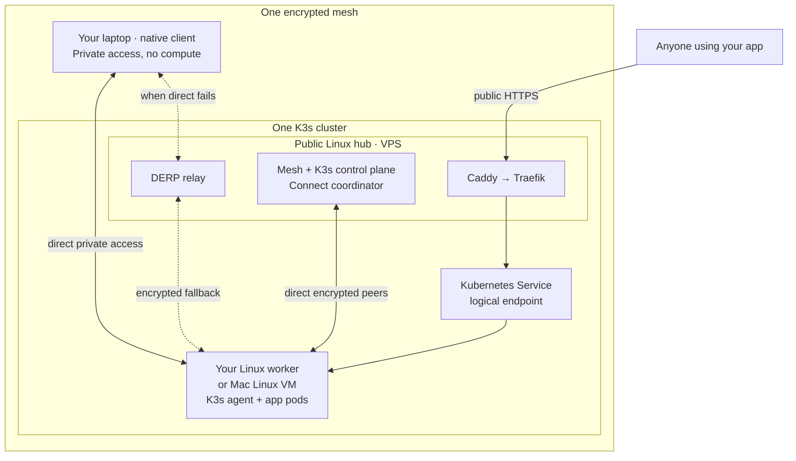

# DeepAI Connect

Turn machines you own into a private cloud. Run applications on a Linux computer
at home or in a Mac's Linux VM, reach them privately from your laptop, and publish
selected services through a public VPS—even when your workers are behind home NAT.

**One `deepai-connect` binary manages one encrypted mesh and one K3s cluster.**
The public hub provides coordination, the Kubernetes control plane and HTTPS
entry. Your workers provide compute while they are online. The target public-hub
budget is **$10–$20/month**; actual hosting costs depend on your provider and usage.

## How it works



- **Private access:** peers connect directly where possible. The coordinator
  tells them how to find and trust one another; it does not carry their ordinary
  traffic. DERP relays encrypted traffic when a direct connection fails.
- **Public access:** a request to your app follows **Caddy → Traefik → Kubernetes
  Service → application pods**. The Service is a cluster endpoint, not another
  machine. Visitors need only a browser and whatever login your app requires.
- **Startup and recovery:** Linux host agents restore saved network identity and
  connectivity before K3s starts. See the [detailed architecture](docs/architecture.md#topology)
  for host services, coordination and recovery boundaries. The drawing shows
  example peer paths; clients can also connect directly to the hub or other peers.

## Choose your starting point

| What you want to do | Start here |
| --- | --- |
| Manage an existing cloud from your laptop | [Install the CLI and configure SSH access](#install-and-use-from-your-terminal) |
| Reach private machines or services | [Join as a native client](#access-an-existing-mesh-from-your-laptop) |
| Create your own cloud | [Prepare and initialize a public hub](#initialize-the-hub), then [add a worker](#join-a-worker-node) |
| Share an application over the Internet | [Publish an existing Kubernetes Service](#publish-an-application) |

Examples use `hub-1`, `worker-1` and `laptop-1`. Replace `203.0.113.10` with your
hub's public IP, `example.com` hostnames with your domains, and `VERSION` with your
chosen release. The example IP is reserved for documentation.

## Install and use from your terminal

**On your laptop:** download the matching binary, `SHA256SUMS` and installer from
[Releases](https://github.com/deepai-cloud/deepai-connect/releases), or extract a
complete `deepai-connect-binaries` bundle from
[CI](https://github.com/deepai-cloud/deepai-connect/actions/workflows/ci.yml).
Choose `darwin` for macOS, `linux` or `windows`, and `arm64` for ARM (including
Apple silicon) or `amd64` for Intel/AMD. Use files from the same build.

From the download directory on macOS/Linux:

```sh
sh install.sh --from-dir .
```

On Windows, run `.\install.ps1 -FromDir .` in PowerShell. Open a new terminal,
then check the installation:

```sh
deepai-connect version
deepai-connect help
```

To manage an **already initialized hub**, first establish SSH key/agent access
and verify its host key. The account must be root or have passwordless sudo.
With OpenSSH installed, run **on your laptop**:

```sh
ssh root@203.0.113.10 exit
deepai-connect setup --hub root@203.0.113.10
deepai-connect status
deepai-connect nodes
```

You should see the hub and any enrolled Kubernetes workers. `setup` saves the
SSH target; it does not join your laptop to the mesh or add its compute. SSH
administration needs no Tailscale client. If you are creating the hub yourself,
complete the [hub steps below](#initialize-the-hub) before these checks.
See [installation and rollback](docs/lifecycle.md#install-the-cli) for source
builds, paths and platform details.

## Access an existing mesh from your laptop

Use this when you want to reach private IPs directly. Ask the hub administrator
for the **coordinator URL**, a short-lived client key and a known private peer or
service to test. The coordinator URL, such as `https://mesh.example.com`, is
separate from an application's browser login page.

If this mesh already has a saved client profile, use [reconnect](#everyday-operations)
instead of creating another identity. The steps below are for first enrollment.

**On the hub, as administrator:**

```sh
sudo deepai-connect enroll --role client --ttl 15m --out /root/laptop-1.key
sudo deepai-connect inspect
```

Transfer the key privately to the laptop. It permits one enrollment within
15 minutes. Use `inspect` to obtain the hub's actual mesh address.

**On a Mac:** install and open the [Tailscale app](https://tailscale.com/docs/install/mac)
and approve its network setup. With the key saved as `~/Downloads/laptop-1.key`,
run this in Terminal:

```sh
chmod 600 "$HOME/Downloads/laptop-1.key"
/Applications/Tailscale.app/Contents/MacOS/Tailscale switch --list
/Applications/Tailscale.app/Contents/MacOS/Tailscale login \
  --nickname=My-cloud --hostname=laptop-1 \
  --login-server=https://mesh.example.com \
  --auth-key="file:$HOME/Downloads/laptop-1.key" --accept-routes
/Applications/Tailscale.app/Contents/MacOS/Tailscale status
/Applications/Tailscale.app/Contents/MacOS/Tailscale ip -4
```

This selects a new login profile; an existing profile remains saved and can be
selected later with `switch PROFILE_ID`. Only one profile is active at a time.
For [Linux or Windows client commands](docs/unified-connect.md#native-clients-and-workload-routing),
use the operating guide. No Tailscale-hosted account is needed for this mesh.

Check the intended profile is running, then use the same Tailscale executable's
`ping HUB_MESH_IP` against the confirmed hub address. Also open a known private
service or check its route. An ordinary IP ping alone can reach an overlapping
address on another network and is not proof of mesh connectivity. `--accept-routes`
enables approved pod/Service routes; it does not select an Internet exit node.
Remove both copies of the key after enrollment and retain the saved client profile.

A connected native client provides **private access only**. It will not appear as
a Kubernetes worker in `nodes`; [adding compute](#join-a-worker-node) is a separate step.

## Initialize the hub

**You need:** a public Linux amd64/arm64 VPS you administer, a public IPv4 address,
DNS names you control and a trusted TLS certificate covering your mesh, relay and
application hostnames. Use a fresh installation; migration from older separate
Connect/Compute deployments is outside this workflow.

Follow [host preparation](docs/unified-connect.md#requirements) first. It covers:

- Linux systemd, root, `/dev/net/tun`, iproute2, iptables and sysctl.
- Connect at `/usr/local/bin/deepai-connect` and **K3s v1.36.4+k3s1** at
  `/usr/local/bin/k3s`, without starting a separate K3s service.
- Building/pushing the Connect service image and making it pullable by the nodes.
- DNS, certificate files, required firewall ports and non-overlapping network ranges.

“One binary” covers Connect's CLI, host agent, coordinator and relay. K3s, Caddy
and Traefik are dependencies. Connect does not purchase a VPS, configure your DNS
or issue public TLS certificates.

**On the prepared VPS:** replace the example values and paths, then run:

```sh
sudo deepai-connect create --name hub-1 \
  --domain mesh.example.com --public-ip 203.0.113.10 \
  --relay-domain relay-1.example.com \
  --image registry.example.com/deepai-connect:VERSION \
  --tls-cert /root/fullchain.pem --tls-key /root/privkey.pem
sudo deepai-connect inspect
```

`create` waits for readiness. `inspect` shows saved identity and mesh readiness.
Configure [laptop SSH administration](#install-and-use-from-your-terminal), then
use `nodes` and `doctor` to check Kubernetes readiness.
For a version-controlled network and node inventory, use
[`cloud.yaml`, `plan` and `apply`](docs/cloud-as-code.md) instead of this imperative
creation path. Once a manifest owns the inventory, issue invitations with
`enroll --node NAME` for its declared nodes.

## Join a worker node

A worker is a Linux machine that supplies CPU, memory and disk to the cluster.
Use the same Connect version as the hub. Bare-metal Linux and Linux VMs follow
the same enrollment steps; the worker needs outbound access, not an SSH server.

**For Mac compute, first create a Linux VM.** Install Multipass and make sure its
service is available to your desktop account. **On your Mac**, preview a resource
grant that leaves room for the host, then create the VM explicitly:

```sh
deepai-connect vm create --name worker-1 --cpus 4 --memory 8GiB --disk 32GiB
deepai-connect vm create --name worker-1 --cpus 4 --memory 8GiB --disk 32GiB --apply
multipass shell worker-1
```

You are now in the **Linux guest**. The grant is an example, not a recommended
minimum or a physical disk reservation. See [worker resource grants](docs/unified-connect.md#worker-resource-grants)
for sizing and resizing an existing VM. Creating the VM alone does not enroll it.

**On the Linux worker or inside that VM:** complete the same
[host preparation](docs/unified-connect.md#requirements) for Connect, K3s and the
Linux prerequisites. Hub-only DNS/TLS preparation is not needed on a worker.

**On the hub:** create an invitation for this worker:

```sh
sudo deepai-connect enroll --role worker --out /root/worker-1.invite
```

Privately transfer it to the worker as `~/worker-1.invite`.

**For a Mac VM:** use `exit` to leave the guest shell. Run these **on your Mac**,
where your hub SSH access is already configured:

```sh
umask 077
scp root@203.0.113.10:/root/worker-1.invite "$HOME/worker-1.invite"
multipass transfer "$HOME/worker-1.invite" worker-1:worker-1.invite
multipass shell worker-1
```

**For a bare Linux worker:** use a private transfer method. If that worker has
its own SSH key access to the hub, the `umask` and `scp` commands above can run
there directly. A fresh VM does not inherit your laptop's SSH keys.

**On the Linux worker or inside the VM:**

```sh
chmod 600 "$HOME/worker-1.invite"
sudo deepai-connect join --name worker-1 --invite "$HOME/worker-1.invite"
sudo deepai-connect inspect
```

Use a unique name and fresh invitation for every worker; the default invitation
expires after one hour. `join` waits for readiness and may take ten minutes.
After success, remove invitation copies.
**Back on your laptop**, confirm `worker-1` is Ready with `deepai-connect nodes`.
For a Mac VM, also save its name with
`deepai-connect setup --hub root@203.0.113.10 --vm worker-1`.

If installation is interrupted, fix the reported cause and run
`sudo deepai-connect resume` **on that same Linux machine**, using the original
state directory. Preserve `/var/lib/deepai-connect`; do not recreate its identity.

## Publish an application

Start with a deployed workload and a Kubernetes Service that has ready backends.
This example assumes Service `my-app` in namespace `default` exposes **Service
port 8080**. Point `app.example.com` to the hub and ensure the installed gateway
certificate covers it. The workload may run on your worker behind home NAT.

**On your laptop**, check the Service and its backends through the hub:

```sh
deepai-connect kubectl -n default get service my-app
deepai-connect kubectl -n default get endpointslices -l kubernetes.io/service-name=my-app
```

**On the hub**, publish that Service:

```sh
sudo deepai-connect publish --hostname app.example.com \
  --service default/my-app --port 8080
```

Open `https://app.example.com` in a browser and check for your app's response or
login page. `publish` configures the HTTPS route; it does not deploy the workload
or add application authentication. Repeating it updates the backend in the same
namespace. See [publication details](docs/unified-connect.md#public-ingress-and-optional-internet-egress)
for routing, hostname changes and certificate rotation.

For a higher-level app creation/deployment experience, see
[App Foundation](https://github.com/deepai-cloud/app-foundation). It owns application
orchestration and the human UI; [platformbase](https://github.com/deepai-cloud/platformbase)
owns shared identity, registry and monitoring services. Connect owns the mesh,
compute membership and publication underneath them.

## Everyday operations

Run these **on your laptop** after `setup`:

| Task | Command |
| --- | --- |
| Overall status and layered diagnosis | `deepai-connect status` / `deepai-connect doctor` |
| Worker readiness and resource use | `deepai-connect nodes` / `deepai-connect nodes --details` |
| Structured mesh and node results | `deepai-connect network --json` / `deepai-connect nodes --json` |
| Application containers and recent logs | `deepai-connect containers -n default` / `deepai-connect logs deployment/my-app -n default --tail=100` |
| Mac VM state and resource grant | `deepai-connect vm status --name worker-1 --json` / `deepai-connect vm resources --name worker-1` |

**Start or stop an existing Mac worker from your Mac:**

```sh
deepai-connect vm start --name worker-1
deepai-connect vm stop --name worker-1
```

Stop shuts down the VM and interrupts its workloads. `vm startup enable --name
worker-1` and `vm startup disable --name worker-1` separately control Connect's
next-login trigger on macOS; they do not change the VM's current state.

**On an enrolled Linux host**, use `sudo deepai-connect host status --json`,
`host start` or `host stop`. Stopping host services is not a workload drain and
does not guarantee every retained container exits. `host startup enable|disable|status`
controls the machine-boot preference separately. See the [lifecycle guide](docs/lifecycle.md)
for exact commands and ownership checks.

**Reconnect a native client** by selecting its saved profile and running plain
Tailscale `up` with the platform's executable. No new key is needed. On a Mac,
list profiles first:

```sh
/Applications/Tailscale.app/Contents/MacOS/Tailscale switch --list
```

If another profile is active, run the same executable with `switch PROFILE_ID`,
using your saved cloud's ID from that list. Then reconnect:

```sh
/Applications/Tailscale.app/Contents/MacOS/Tailscale up
```

Plain `up` retains settings; adding flags such as `--timeout` may require
repeating all nondefault settings. Follow that settings check without `--reset`
or re-enrollment.

Agents can use the supported CLI and structured results, with the focused
[Connect lifecycle skill](.agents/skills/deepai-connect-lifecycle/SKILL.md) for
installation, target selection, diagnosis and recovery. Read JSON together with
the exit status. Installing the binary does not enable the repository skill.

## When something looks wrong

| Symptom | What to check |
| --- | --- |
| “I ran setup, but private IPs do not work.” | `setup` selects an SSH target. Complete native-client enrollment for direct private access. |
| “The VPN is connected, but my laptop is missing from nodes.” | Native clients join the mesh only. Compute requires an enrolled Linux worker or Mac Linux VM. |
| “Doctor reports an old worker Not Ready.” | Check the named worker independently. A working native client does not make an offline worker Ready; keep their identities separate. |
| “The client opens a login page or uses the wrong network.” | Confirm the coordinator URL and active Tailscale profile. A platform session/login URL is not a coordinator URL. |
| “Ping works, but the private app does not.” | Verify active mesh state, a confirmed peer/private route, route acceptance and the app's ready backends. A normal ping can hit a different network. |
| “Create or join stopped halfway.” | Fix the failed prerequisite and use `resume` with the original state directory. Do not delete state or issue a new identity to retry. |

## Current limits and further reading

Linux amd64/arm64 is the supported hub/worker runtime; Mac compute uses a Linux
VM. Windows CLI installation and SSH administration are distinct from unqualified
Windows worker, VPN and automatic-start support. See the
[platform matrix](docs/lifecycle.md#platform-and-verification-boundaries).

One VPS is a single point of failure. [Additional hubs](docs/unified-connect.md#add-another-hub)
and three or five etcd voters are topology options; independent-host failover and
cross-region control planes still need qualification. Cached mesh state helps
trusted peers reconnect while Kubernetes is down, but expires after 30 days
without authenticated synchronization and cannot replace etcd quorum. Worker
disks are not shared or replicated storage; keep [consistent off-host backups](docs/unified-connect.md#durable-state-and-recovery).

- [Operating guide](docs/unified-connect.md) — preparation, routes, publication and recovery.
- [Architecture](docs/architecture.md) — component boundaries, startup ordering and persistence.
- [Cloud configuration as code](docs/cloud-as-code.md) — declarative inventory, plans and named enrollment.
- [Development and tests](docs/testing-unified.md) — with Go 1.26.9+, `go run ./cmd/release -version VERSION` builds all six binaries; build the service image separately.
- [MIT license](LICENSE).

This README describes the supported source contract. Documentation validation does
not establish the current health of a deployed cluster.
