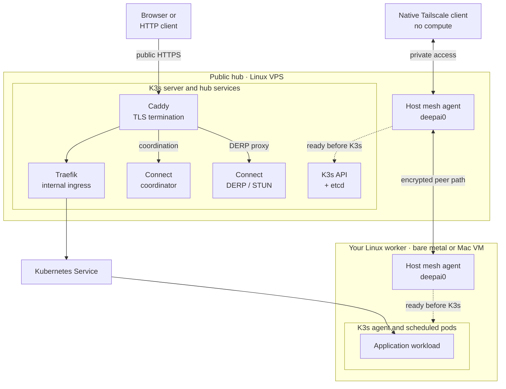

# Architecture

DeepAI Connect is the network and compute foundation of DeepAI Cloud: **one binary,
one encrypted mesh and one K3s cluster** across a public hub and owned workers.
The initial public hub targets $10–$20/month; worker hardware supplies additional
compute. This is a design budget, not a hosting offer or an availability guarantee.

The Linux amd64/arm64 executable exposes cluster creation, enrollment, recovery, routing
and publication commands. It also runs the host agent and cluster-managed
coordinator and relay processes.
The same command runs natively on macOS and Windows for SSH-based cluster
administration; host networking and K3s lifecycle commands require Linux.
Native laptop access to the private network uses a separately installed Tailscale
client pointed at the Connect coordinator. SSH administration needs no mesh
client, and Linux hubs/workers already embed the mesh engine.
Installations are greenfield; migration from the earlier separate Connect or
Compute deployments is outside the supported workflow.

The [lifecycle CLI](lifecycle.md) operates existing named VMs and owned Linux
services. macOS VM automatic start is a per-user login LaunchAgent; Linux host
automatic start is systemd boot enablement, persisted separately from immediate
service state. No additional launcher daemon is introduced. Multipass owns its
hypervisor service and any independent VM restoration; native mesh clients and
Gateway Node/Ollama retain separate startup ownership. Windows worker/logon
automation remains unqualified.

## Topology

The diagram shows the initial one-hub topology and one example worker. The two
Linux hosts join the same K3s cluster. Their mesh agents run as host services,
outside Kubernetes; a native client joins only the mesh.

Solid arrows show traffic paths; dotted arrows show startup ordering. The Service
is a cluster abstraction, not a process pinned to the hub. The coordinator
distributes membership, policy and peer information; ordinary peer traffic does
not pass through it. Direct encrypted paths are preferred between any eligible
peers, including clients and workers. If direct connectivity fails, peers use
the hub's DERP relay; STUN is reached separately over UDP. The drawing omits
individual fallback links and the Kubernetes control connections for clarity.

The host mesh carries cross-node Kubernetes traffic, with Flannel bound to
`deepai0`. Caddy routes coordination and relay HTTPS separately from application
hostnames; only the application path passes through Traefik. Native clients
can reach approved host, pod and Service routes without supplying compute.
The coordinator's URL is a protocol endpoint, not the human platform sign-in URL.

## Product and dependency boundaries

“One binary” means Connect's CLI, host agent, coordinator and relay share one
executable. K3s, Caddy and Traefik are separate dependencies. The Linux binary,
K3s executable, Connect service image, DNS and a covering TLS certificate must
be prepared before hub creation; Connect does not issue public certificates.
See [host preparation](unified-connect.md#requirements).

Connect owns mesh, cluster membership, node lifecycle and publication.
[platformbase](https://github.com/deepai-cloud/platformbase) owns shared platform
services such as identity, registry, observability and GitOps infrastructure;
[App Foundation](https://github.com/deepai-cloud/app-foundation) owns application
orchestration and its human UI. The separately owned AI gateway is not Connect's
Caddy ingress or optional Internet-egress role. These application/platform
services are not required to establish the Connect mesh and cluster.

Agent operation uses the supported CLI: declarative `plan`/`apply`, enrollment,
publication and diagnostic commands, with structured output where documented.
The focused [lifecycle skill](../.agents/skills/deepai-connect-lifecycle/SKILL.md)
packages installation, target selection, status, start/stop and recovery; it is
repository guidance, not an additional running agent service. SSH administration,
native-client enrollment and Linux worker enrollment remain distinct workflows.

## Host networking and Kubernetes

`deepai-connect-agent.service` owns the host's `deepai0` interface through the
upstream Tailscale WireGuard engine. It persists machine, node and discovery
identity, approved policy, peer endpoints and relay information. At startup it
restores that state before accepting new coordination updates.

`deepai-connect-k3s.service` requires the agent and waits for its readiness gate.
K3s advertises overlay addresses and binds Flannel to `deepai0`. Kubernetes uses
distinct host, pod and Service ranges. The first hub initializes embedded etcd;
additional hubs join as voting or non-voting control-plane servers. Workers
run K3s agents. Voter admission is serialized and checks cluster health.

Existing CNI and host firewall rules retain their ownership. Connect's routing
and firewall code manages its own rules, preserves forwarding denials, and
keeps the physical default route. Internet egress requires an explicit gateway
role and per-source opt-in.

## Shared control services

The coordinator implements Tailscale registration and network-map protocols.
Replicas share membership, address allocation, policy and enrollment state in a
namespaced `NetworkState` custom resource. Kubernetes `resourceVersion` provides
compare-and-swap updates. Secrets `connect-coordinator-keys`,
`connect-enrollment` and `connect-gateway-tls` hold the shared Noise identity,
enrollment/admin/relay credentials and gateway TLS identity respectively.
Device private keys remain on their hosts. A Kubernetes Lease serializes shared
service reconciliation across hubs.

Each hub runs DERP/STUN and a Caddy HTTPS gateway. Direct encrypted peer paths
are preferred; DERP forwards encrypted packets when direct connectivity fails.
Public application requests follow Caddy → Traefik → Kubernetes Service.
Publishing creates a Gateway API v1 HTTPRoute and updates the configured Caddy
hostnames. A shared `connect-public` Gateway selects explicitly enabled
namespaces. Traefik is an internal ClusterIP Service behind Caddy; its Gateway
provider and narrow trust for protected hub proxy addresses are maintained in
the K3s HelmChartConfig. Caddy applies bounded application proxy retries.
Simple legacy Connect Ingresses can be migrated by repeating `publish`; the
legacy object is deleted only after the replacement route is accepted.

CoreDNS and Traefik each run at least two replicas on protected hub nodes, with
preferred spreading across hostnames. The first hub can host both replicas;
additional hubs allow separate placement. Create, join, and resume reconcile
these dependencies and wait for readiness. The coordinator also checks them
every 30 seconds so packaged K3s or Helm reconciliation after reboot cannot
leave them at a single replica. Narrow patches preserve their packaged images,
configuration, service accounts, and Services.

Secret-bearing services use the administrator-applied
`connect.deepai.cloud.node-restriction.kubernetes.io/role=hub` label.
NodeRestriction prevents worker kubelets from assigning it to attract those pods.
Worker enrollment receives expiring bootstrap credentials; hub enrollment
requires a separate role-authorized invitation and receives server credentials.

## Declarative cloud configuration

[`cloud.yaml`](cloud-as-code.md) describes the network, bootstrap hub and named
hub/worker inventory. The administrative CLI can use SSH to run `plan`, `apply`
and named enrollment on the bootstrap hub. Workers initiate their own HTTPS
enrollment and configuration requests; they require no SSH access.

The desired manifest and effective packet policy are persisted with enrollment
membership in the same `NetworkState` compare-and-swap transaction. A revision
hash identifies the desired configuration. Invitations are scoped to a declared
node name, role and voter membership; existing devices authenticate configuration
pulls with their persistent enrollment key. A grant contains only that node's
declaration, without the administrator's SSH connection.

Agents cache their configuration separately from installation and network state
and poll every 30 seconds. The coordinator reconciles manifest-owned Kubernetes
labels after checking enrolled identity, assigned address, roles and readiness.
It preserves unrelated labels, rejects reserved namespaces, and fences patches
with the Node's `resourceVersion`. Its dedicated ClusterRole grants node patch
access; field and ownership restrictions are enforced by the trusted controller.

Configuration pulls do not gate mesh recovery or extend cached network trust.
Changing installed networks, images, voter topology or enrolled hub endpoints
requires an explicit migration; manifest reconciliation preserves device
identity and does not decommission nodes.

## Code boundaries

| Path | Responsibility |
| --- | --- |
| `cmd/deepai-connect` | Primary command entry point into `internal/unified` |
| `internal/unified` | Host lifecycle, operator commands and component integration |
| `internal/desktop` | Laptop access, diagnostics, remote kubectl, kubeconfig and named VM/login lifecycle |
| `internal/hostnet` | Overlay identity, transport, routes, firewall and cached recovery |
| `internal/coordinator` | Tailscale protocol, durable registry and Kubernetes state store |
| `internal/enrollment` | Signed, resumable role-specific admission and credential release |
| `internal/cloudconfig` | Strict declarative manifest schema and validation |
| `internal/cluster` | K3s configuration, systemd ordering and Kubernetes services |
| `internal/relay` | Owned DERP/STUN process and peer admission |
| `internal/platform` | Private files, directory and process locks |
| `cmd/release`, `internal/buildinfo` | Linux/macOS/Windows artifacts, checksums and embedded version |
| `internal/architecture` | Standalone module and supported executable-target checks |

Architecture tests verify the standalone module has no replacements, includes
the executable on Linux/macOS/Windows amd64/arm64, and excludes it on unsupported targets.
Release builds ignore parent Go workspaces and reset architecture optimization
flags to the supported baseline CPUs.

## Persistence and recovery

Host state defaults to `/var/lib/deepai-connect`. `unified.json` records the
installation phase, `network/` contains the overlay identity and trusted cache,
and `cluster/` contains K3s configuration and datastore files. Writes precede
runtime transitions so interrupted operations can resume with the same device
and cluster identity. Worker credential reloads are journaled; a confirmed join
does not become pending again during a later API outage.

Networking can restore cached peer connectivity while Kubernetes and its
coordinator are unavailable. Cached trust has a bounded lifetime. Back up host
state, K3s server tokens, etcd snapshots and application volumes using their
respective consistency requirements. See the [operating guide](unified-connect.md)
and [Linux acceptance procedure](testing-unified.md) for exact commands and
failure assertions.

The host agent reports successful authenticated map application to the upstream
transport's control-health tracker. This permits a new home relay to be
selected and advertised while coordination is available. Offline cache startup,
failed or invalid map requests, cancellation, and shutdown clear that signal;
cached connectivity alone cannot authorize a relay-location change.

After a coordinator transport timeout, the next authenticated, persisted map
triggers upstream path rebinding and discovery. Key discovery uses a fresh
connection pool so a stale HTTPS connection cannot block that recovery.
A relay-only failure with healthy control requests does not trigger rebinding
and can still wait for upstream's receive timeout (about 120 seconds). No fixed
recovery bound or survival of in-flight requests is promised for NAT/VPN changes.

## Availability and qualification

The initial VPS is a single failure domain for public ingress, coordination and
the control plane. Multiple replicas on that VPS do not provide independent-host
availability. Additional hubs can join as voters or non-voters; the default
target is three etcd voters, with five also supported. Admission and reconciliation
code do not establish independent-host failover or cross-region qualification.

Cached peer connectivity is independent of Kubernetes, but its trust expires
after 30 days without authenticated synchronization. It still needs usable peer
paths or a reachable relay; it cannot create etcd quorum, authorize new members
offline or guarantee recovery across arbitrary NAT changes.

Workers supply eligible compute only while ON. A Mac's Linux VM bounds the
resources offered to Kubernetes; stopping that VM interrupts its workloads.
Local disks are not a pooled or replicated storage system. Application data
needs separate redundancy and consistent backups, including off-host recovery.

Linux amd64/arm64 is the hub/worker runtime scope. macOS has a native CLI and
private-client path; compute uses a Linux VM. Windows CLI build/native amd64 CI
coverage is distinct from worker, VPN and startup qualification. The
[lifecycle support matrix](lifecycle.md#platform-and-verification-boundaries)
and [dated acceptance](lifecycle-acceptance-2026-10-26.md) preserve those limits.
This document describes implementation boundaries, not the current health of
any deployed hub or previously tested worker.

## Distribution

`go run ./cmd/release -version BUILD` produces Linux, macOS and Windows arm64/amd64
executables (Windows uses `.exe`), `install.sh`, `install.ps1`, `manifest.json` and
`SHA256SUMS`. The release builder stages the complete output
and preserves the previous output on compilation failure. The Dockerfile builds
the same executable for the coordinator and relay image. Host K3s is a separate
pinned, verified dependency.

The release builder does not upload or sign artifacts. CI runs native CLI and
installer checks on Linux, macOS and Windows runners before the tag workflow
publishes a GitHub Release. The Windows job executes amd64; Windows arm64
currently receives cross-compilation coverage.
These checks do not establish Windows worker or native VPN interoperability.
Distribute executables, images and checksums; keep installation state and
credentials private.
